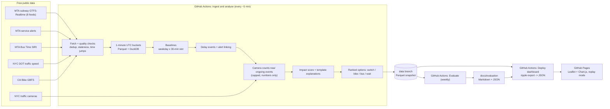

# NYC Subway Disruption Ripple

[](https://github.com/edwinteng/nyc-transit-ripple/actions/workflows/ci.yml)

**When the subway breaks down, does the street break down too?** This project watches
New York City's subway in near real time, detects disruptions, measures what happens
on the streets around the affected stations, and tells riders whether to switch
lines, take a bike or a bus, or wait. It runs entirely on free public data and free
GitHub Actions, with no servers, no paid APIs and no language models.

**Live dashboard:** <https://edwinteng.github.io/nyc-transit-ripple/> ·
**Evaluation:** [latest report](docs/evaluation/latest.md) ·
**Case study:** [docs/case-study.md](docs/case-study.md)


> **Replay mode (animated GIF placeholder).** A short recording of the replay slider
> will go here: pick a past event, press Play, and watch the station delays on the
> map, the timelines and the suggested options change minute by minute. Until then,
> open any notable event on the [live dashboard](https://edwinteng.github.io/nyc-transit-ripple/)
> and press "Replay".

## The problem

When a subway line is disrupted, thousands of riders leave the platform at the same
moment, and navigation apps send most of them to the same "obvious" alternative: the
nearest other line, the bus that runs along the avenue, the Citi Bike dock outside the
station. That alternative then overloads in turn. Riders get no signal about it, and
agencies rarely measure it. This project asks how big, how long and where the surface
ripple of a subway disruption is, and gives a ranked, explained answer to "go,
switch or wait?".

**A concrete scenario.** It is 8:15 on a weekday and a signal problem suspends the A/C
between Jay St-MetroTech and Hoyt-Schermerhorn. Within minutes the B67 and B25 stops
on Jay Street fill up, the docks on Willoughby Street empty, and traffic on the
Flatbush Avenue Extension slows. Everyone was told to "take the bus". The dashboard
flags the event and scores the street impact. For riders at Jay St it ranks the
options: switch to the F at the same station, with the next train in 2 minutes; walk
4 minutes to Borough Hall for the 2/4; take a Citi Bike; or wait, given how long
similar signal problems at rush hour have lasted. The obvious option is penalized if
buses on that route are already crawling or the docks are running out.

## What it does

- **Detects subway delay events** from all eight MTA GTFS-Realtime feeds. An event
  is a line whose median train delay stays at least 5 minutes late for 5 minutes. It
  links events to MTA service alerts.
- **Measures the street around the affected stations** within 500 m: road speeds
  (NYC DOT), bus speeds (MTA Bus Time), Citi Bike availability, and vehicle and person
  counts from traffic cameras (an open-source detector that keeps numbers, never
  images). Each signal is compared with the usual level for that weekday and time of
  day, giving a **0-100 surface impact score**.
- **Recommends options** for every affected station: another line (next train from
  live predictions), Citi Bike, bus, or wait (from how long similar past disruptions
  lasted). The obvious option is penalized when it already looks crowded.
- **Explains everything in plain English** with fixed templates. Every number in a
  sentence is stored with it and checked automatically.
- **Evaluates itself every week:** detection against official alerts, a placebo test
  of the surface impact, camera accuracy, a replay of every logged recommendation,
  explanation consistency, and pipeline reliability.
- **Publishes a static dashboard** with a map, event timelines, a **replay mode** for
  any past event, notable events chosen automatically, and an evaluation page.

## Architecture



The `transit_ripple` Python package does all the work, through the `ripple` and
`ripple-cameras` commands. Data lives as Hive-partitioned Parquet with naive UTC
timestamps, queried through DuckDB views that deduplicate rows. Each run publishes a
single snapshot commit to the `data` branch. The website is plain HTML, CSS and
JavaScript, served from compact JSON exported at deploy time; the browser never sees
Parquet.

## Key engineering decisions and trade-offs

**Multi-rate time alignment.** Subway feeds update every 30 seconds, Citi Bike every
minute, DOT traffic speeds every 5 minutes (sometimes hours late), cameras only when
asked, and GitHub runs the scheduler "about" every 5 minutes. Everything is bucketed
to 1-minute UTC slots, keeping both observation and fetch times. Values are
forward-filled only up to a per-source maximum age, with that age recorded. Past the
limit, a value becomes missing; it is never stale-but-assumed-current.
Same-weekday, same-time-of-day baselines use local New York time, so rush hours line
up across daylight-saving changes.

**Data quality is a first-class output.** Every run writes a quality report covering
deduplication, stale and future timestamps, time jumps, implausible delays,
schedule-match rates and coverage. A stale or failed source is marked
*missing* or *unavailable*, never "normal". The site shows the freshness of each
source. Low-confidence baselines (fewer than 3 comparable days) are excluded from the
impact score instead of quietly used, and the score is renormalized over the signals
that remain.

**Cost control.**
- **Zero paid APIs.** Every feed is free; the only keys are free ones held in GitHub
  Secrets.
- **Cameras only during events.** Object detection, the expensive step, runs only
  while a disruption is ongoing, near its worst stations, capped at 30 cameras per
  run.
- **Rule-based text.** Explanations come from templates rather than an LLM. They cost
  nothing and are deterministic, and an automated checker can prove that no sentence
  states a number that is not in the data.
- **Bounded storage.** Raw detail is kept as short-lived workflow artifacts; only
  aggregates live on the data branch.

**GitHub Actions security.**
- **Minimal permissions.** The default token is read-only; only the job that commits
  data can write, and only the Pages deploy job gets `pages: write` and
  `id-token: write`.
- **Pinned actions.** Every third-party action is pinned to a commit SHA.
- **Secrets stay away from pull requests.** Secrets are used only by scheduled or
  manually dispatched workflows, which never run for pull requests, and
  `pull_request_target` is not used. Keys are read from environment variables, never
  logged, and stripped from the URLs stored in reports.

**Honest uncertainty.** Every metric shows its sample size and date range, and small
samples are labeled *preliminary*. Each recommendation carries a confidence level
and the inputs behind it. The evaluation reports negative or inconclusive results as
they are.

## Evaluation results

From the [first report](docs/evaluation/latest.md) (2026-11-01). It covers only a few
hours of data, because the scheduled pipeline had not started running yet, so
**every number below is preliminary**. The weekly report replaces it automatically.

| What | Result | Sample |
|---|---|---|
| Detected events matching an unplanned MTA alert (precision) | 33% | 6 events |
| Alerts with a matching detected event (recall, while data was collected) | 50% | 4 alert-lines |
| Median time to detect (event start minus alert time) | +3.9 min | 2 matches |
| Surface impact placebo test | not enough data yet | 0 events with matched non-event days |
| Camera counting accuracy | not evaluated yet: no manual labels | 0 frames |
| Recommendation replay | no recommendations logged yet | 0 |
| Explanation sentences with an uncited number | 0 | 12 sentences |
| Median time between ingest runs | 54.6 min (2 manual runs) | 2 runs |

See the [Evaluation page](https://edwinteng.github.io/nyc-transit-ripple/evaluation.html)
for charts, confidence intervals and caveats.

## Limitations and future work

- **No destination yet.** Options are ranked by the time to get 4 km away from the
  station. **Destination-aware routing** (origin-destination travel times on each
  mode) is the main next step.
- **Longer history.** Baselines, the recovery model and the placebo test all need
  weeks to months of continuous data. The "wait" estimate falls back to broader groups
  (marked low confidence) until then.
- **Better ground truth.** MTA alerts are late, missing for short delays, and sometimes
  describe planned work. Better ground truth would come from hand-labeled incidents,
  official delay statistics, or crowd-sourced reports.
- **Coverage of free data.** Traffic sensors cover mostly highways and arterials.
  Cameras are only counted during events. Bus speeds need a working Bus Time key.
  Station crowding itself is not observable.
- **Scheduling.** GitHub runs scheduled workflows on a best-effort basis; gaps are
  recorded and shown, not hidden. Long-term storage should move from a git branch to
  object storage or release assets.
- **Associations, not causation.** The placebo test guards against chance and
  city-wide effects but cannot prove that a disruption caused a slowdown.

## Run it locally

Requires Python 3.11+ and [uv](https://docs.astral.sh/uv/).

```bash
uv sync --extra vision
```

```bash
uv run ripple ingest --sources subway,bus,alerts,traffic,bikes --polls 6 --interval 60
```

```bash
uv run ripple baselines && uv run ripple events && uv run ripple recommend
```

```bash
uv run ripple export --out site/data && python -m http.server 8000 -d site
```

Then open <http://localhost:8000/>. Bus data needs a free MTA Bus Time key in the
`MTA_BUS_API_KEY` environment variable (or a local `.env` file); without it, bus data
is reported as unavailable and everything else works. To use the history collected by
the scheduled pipeline instead, export from the data branch:

```bash
git fetch origin data && git worktree add ../ripple-data origin/data
```

```bash
uv run ripple export --data-dir ../ripple-data --out site/data
```

## Reproduce the evaluation

```bash
uv run ripple evaluate --data-dir ../ripple-data --out /tmp/evaluation --check-explanations
```

This writes `latest.md`, `latest.json` and a dated copy, and exits with an error if
any explanation contains a number that is not in its metrics. Copy `latest.json` to
`site/data/evaluation.json` to see it on the local Evaluation page. Workflow
reliability statistics are added when `GITHUB_TOKEN` and `GITHUB_REPOSITORY` are set,
as they are in the weekly workflow. To evaluate the camera detector, follow
[docs/cameras.md](docs/cameras.md#accuracy-evaluation). Then save the filled-in
`labels.csv` and the resulting `predictions.csv` (numbers only) as
`docs/evaluation/camera_labels.csv` and `docs/evaluation/camera_predictions.csv`.

Tests (all offline): `uv run pytest`; lint: `uv run ruff check . && uv run ruff format --check .`.

## Documentation

- [Design document](docs/design.md): goals, architecture, milestones and revision history
- [Data model](docs/data-model.md): tables, quality rules, events, the impact score,
  recommendations, the export schema
- [Operations](docs/operations.md): commands, configuration, workflows, known
  limitations by milestone
- [Runbook](docs/runbook.md): what to do when a feed or workflow fails
- [Traffic cameras](docs/cameras.md): detector, license and accuracy evaluation
- [Case study](docs/case-study.md): the story, results and lessons learned
- [Evaluation reports](docs/evaluation/)

Data: MTA, NYC DOT / NYC Open Data, NYCTMC, Citi Bike (Lyft). Map data © OpenStreetMap
contributors. Not affiliated with any of them.
